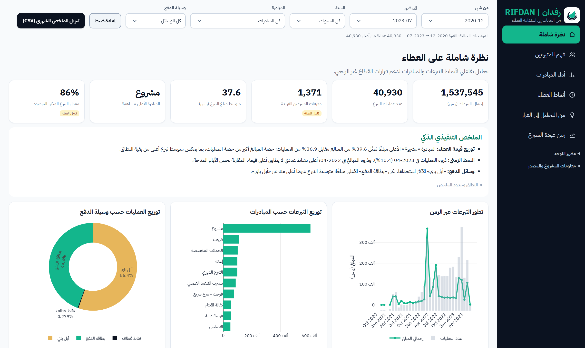

# RIFDAN | رفدان — Donation Analytics and Decision Support

**From data to sustainable giving.** RIFDAN is an end-to-end data analytics portfolio project on a historical sample of 40,930 donations from Saudi Arabia's Ehsan platform. It takes open data through cleaning, statistical analysis and modelling to an interactive Arabic dashboard and an executive report with testable recommendations.

| Start here | What it is | Needs the dataset? |
|---|---|---|
| [`outputs/dashboard/RIFDAN_Dashboard.html`](outputs/dashboard/RIFDAN_Dashboard.html) | Interactive dashboard; [open it online](https://ziyadell.github.io/RIFDAN-Data-Analytics/outputs/dashboard/RIFDAN_Dashboard.html), or download the file and open it in a browser | No |
| [`report/executive_summary.pdf`](report/executive_summary.pdf) | 8-page executive report (Arabic) | No |
| [`analysis.ipynb`](analysis.ipynb) | Full analysis with saved outputs | To read: no. To re-run: yes |

## Problem statement

Non-profits see donation totals but rarely know where value is concentrated or which change is most worth testing. RIFDAN answers one measurable question:

> **Where is donation value concentrated in the sample, and what is the largest measurable intervention a non-profit could test to make giving more sustainable?**

## Objectives

- Measure how concentrated donations are, by donor identifier and by initiative.
- Measure how quickly donors give a second time, and what explains the differences.
- Size what one percentage point of improvement in second-gift return is worth, in Saudi riyals (SAR, ر.س).
- Turn the findings into prioritised recommendations and pre-registered experiment plans.

## Technologies and tools

| Area | Tools |
|---|---|
| Data and statistics | Python, pandas, NumPy, SciPy |
| Modelling | scikit-learn (K-Means, Logistic Regression, Gradient Boosting), lifelines (Kaplan-Meier, Cox) |
| Visualisation | matplotlib, seaborn, Plotly.js 4.1.1 |
| Dashboard | Self-contained HTML, CSS and JavaScript with a right-to-left Arabic interface |
| Reporting | ReportLab, arabic-reshaper, python-bidi, Jupyter |
| Validation | Python checks, Node.js with jsdom |

## Data

**Source:** ["A sample of donations for different IDs in Ehsan"](https://open.data.gov.sa/ar/datasets/view/cc3b177a-5e5d-4845-bb92-6119b1322b05) (Arabic title: «عينة لتبرعات 1500 معرف على منصة احسان») on the Saudi Open Data Platform. The analysed file contains 1,371 observed identifiers.

| Item | Value |
|---|---|
| Records | 40,931 raw; 40,930 donations after cleaning |
| Period | 2020-12-14 to 2023-07-13; first and last months are partial, and February 2021 has no records |
| Scope | 1,371 observed identifiers, 22 initiatives, 3 payment methods |
| Titles | 1,702 distinct before cleaning; 1,701 after, because the removed record's title appears nowhere else |
| Columns | `UserID`, `CreationTime`, `Title`, `Amount`, `InitiativeName`, `PaymentMethod` |

**The raw and cleaned files are not in this repository.** They contain pseudonymous donor identifiers, the licence does not cover personal data (clause 4.3-d), and their public redistribution has not been verified as permissible. [`data_raw/README.md`](data_raw/README.md) explains how to download the dataset and confirm the version.

## Data preparation and exploratory analysis

- Standardised column names, trimmed whitespace, and converted amounts and dates to proper types.
- Removed one record with a non-numeric amount and filled one missing title with «غير محدد».
- Flagged 202 records identical to earlier ones without deleting them, because no transaction ID proves they are errors; a sensitivity analysis measures their effect.
- Explored trends over time, initiatives and donation opportunities, payment methods, activity by weekday and hour, donation frequency, and concentration of amounts.

## Advanced analytics and models

**Donor segmentation (RFM + K-Means).** Recency, frequency and monetary value were log-transformed and standardised, and k = 2 to 6 were tested. Three segments were chosen for practical use (silhouette 0.303), although two segments score highest statistically (0.386). The split is stable across random seeds (minimum Adjusted Rand Index 1.00).

**Time to second gift (survival analysis).** A Kaplan-Meier estimator treats donors who had not returned as right-censored rather than as failures. The cohort has 1,290 identifiers: 1,137 returned and 153 are censored.

**Confounder adjustment (Cox model).** A log-rank test first showed a difference by first-gift size (53.2% vs 45.5% returning within 30 days, p = 0.0086). A Cox proportional hazards model with initiative, payment method and gift size together removes that effect (hazard ratio 0.980, 95% CI 0.936–1.027, p = 0.40). Entry point matters instead: «الحملات المخصصة» (HR 0.72, p = 0.0243) and «زكاة الفطر» (HR 0.62, p = 0.0015), compared with «إغاثة». The proportional hazards assumption was not tested, and the C-index of 0.588 shows the available factors explain little of the variation.

**Peak-window significance.** Because the same identifier donates repeatedly, amounts are not independent, so the conclusion rests on an identifier-level cluster bootstrap (2,000 resamples). Both confidence intervals include zero: the window stands out for activity, not for gift value.

**Value sizing.** One percentage point more second-gift return corresponds to between 129 and 2,451 SAR (0.01%–0.16% of the sample total). The upper bound is a descriptive association, not a causal effect, and implementation costs are not included.

**Return prediction (exploratory).** Predicts whether an identifier donates within 90 days of a cutoff, using only earlier transactions and sequential time splits. The model was chosen on validation data and evaluated once on the test window.

| Evaluation | AUC |
|---|---|
| Validation: Logistic Regression | 0.774 |
| Validation: Gradient Boosting | 0.713 |
| Test: chosen Logistic Regression | 0.729 |
| Test: baseline (donation count) | 0.707 |

The 0.022 test advantage is within sampling noise (95% CI −0.001 to +0.045) and comes from a single window.

## Key findings

| Metric | Value |
|---|---|
| Donations | 40,930 |
| Total amount | 1,537,545 SAR |
| Observed donor identifiers | 1,371 |
| Mean / median donation | 37.6 / 10 SAR |
| Largest identifier's share of amounts | 27.2% |
| Top initiative | «مشروع», 39.6% of amounts |
| Return for a second gift within 30 days | 50.1% (median 30 days) |
| What explains return speed | Initiative; not first-gift size or payment method |
| Return rate across monthly entry cohorts | 25.0% to 70.9% (median 45.5%) |

**Recommended first step:** address dependence on one donor identifier, which is linked to 27.2% of amounts. Verify what the identifier represents, report with and without it, and plan donor diversification. Then run a second-gift journey experiment with a decision rule set in advance. The dashboard lists 8 recommendations and 3 experiment plans, ranked by the amount affected. All are proposals to test, not proven results.

## Interactive dashboard

[](https://ziyadell.github.io/RIFDAN-Data-Analytics/outputs/dashboard/RIFDAN_Dashboard.html)

### [Explore Interactive Dashboard](https://ziyadell.github.io/RIFDAN-Data-Analytics/outputs/dashboard/RIFDAN_Dashboard.html)

An Arabic, single-file dashboard that runs in the browser without a server or dataset. Open it online through GitHub Pages, or download the file and open it locally. The screenshot shows the overview page of the current public dashboard with no filters applied.

| Page | Content |
|---|---|
| نظرة شاملة (Overview) | KPIs, trends, and amounts by initiative and payment method |
| فهم المتبرعين (Donors) | Frequency, recency, value, RFM segments and model results |
| أداء المبادرات (Initiatives) | Rankings, opportunities, trends and two-initiative comparison |
| أنماط العطاء (Giving patterns) | Activity by month, weekday and hour; payment methods over time |
| زمن عودة المتبرع (Time to return) | Kaplan-Meier curve, Cox hazard ratios, cohorts and value sizing |
| من التحليل إلى القرار (Decisions) | Recommendations and experiment plans |

Filters cover month range, year, initiative and payment method, with a reset and a monthly summary CSV export. To protect privacy, the date filter works in whole months; see [Privacy safeguards](#privacy-safeguards) for how this affects narrower views. Donor, model and recommendation analyses always use the full sample and are labelled that way.

## Executive report

[`report/executive_summary.pdf`](report/executive_summary.pdf) covers the problem, data, cleaning, methodology, findings, advanced analytics, recommendations, implementation plans and limits. `scripts/build_report.py` rebuilds it from `outputs/metrics.json` and `outputs/figures`.

## Privacy safeguards

No donor identifier appears in the published files: a text search for all 1,371 found no match, and the figures and report pages were reviewed visually. Saved notebook tables mask the identifier, exact time and title.

The public dashboard's data was aggregated further, and reconstruction attacks that join the public tables were run against it:

| Safeguard | Rule |
|---|---|
| Monthly dates | All dashboard data stops at the month, so the date filter selects whole months and no daily view exists |
| Hour patterns | Counts only, with no amounts, by month, weekday, hour, initiative and payment method |
| Donation titles | Shown only when used by at least 5 identifiers and 5 transactions; 532 of 1,701 titles are shown, covering 91.7% of amounts |
| Named individuals | Titles that pass those thresholds but name a private individual are also withheld; the script stores only their SHA-256 hashes |
| Small cells | Title and hour cells with fewer than 3 transactions roll up to the year, or to whole-period totals when still too small |
| Timestamps | First and last transaction times are published as dates only |

**Effect on the dashboard.** Totals, months, initiatives and payment methods stay exact for any month range, and withheld titles remain in all totals as one labelled pool, which isn't ranked. Full-period hour charts and title rankings are also exact. Rolled-up cells are left out of those two when a filter selects part of their year or period, or a payment method; hour charts also leave them out under an initiative filter. Those narrower views can therefore undercount slightly, and notes on the charts say so. No analytical result, finding or recommendation changed.

**Attack results.** Exact hour for a single transaction: 0 recovered. Title linked to a single transaction's month: 0 recovered.

**Remaining limits.** None of these includes a donor identifier:

- **Single transactions:** 84 month, initiative and payment cells (0.21% of transactions) show one transaction's exact amount; the largest is 1,800 SAR. These include two initiatives with one transaction each, and the only transaction in December 2020, whose date follows from the published start date.
- **Rare titles:** 146 whole-period title cells show one transaction's title, initiative and amount, with no date or payment method.
- **Dominant donors:** one identifier gives at least 85% of the amount in 3 initiatives and 37 shown titles, so those totals approximate one donor's giving. The largest identifier's share (27.2%) and transaction count (93) are published because they are a key finding.
- **Figure 09:** the segmentation scatter plots each identifier as an unlabelled point, and also appears in the notebook and report.

The original dataset, with identifiers, remains available from the platform.

## Limitations

- A historical sample that doesn't represent all donors or current platform activity; absence from it doesn't prove a donor stopped giving.
- Partial months and gaps limit time comparisons, and the time zone is undocumented.
- Results are descriptive, not causal, and no costs or campaign targets are available to measure return.
- An identifier is an observed pseudonym, not a complete record of a person, and the meaning of «نقاط قطاف» as a payment method is undocumented.
- Segments overlap somewhat, and the predictive model needs evaluation over more periods before any operational use.

## Installation and reproducibility

### Explore without the dataset

Open the dashboard, report, notebook, `outputs/metrics.json` or `outputs/figures` directly. Nothing needs to be installed.

### Reproduce the analysis

Requires Python 3.13. Download the dataset as described in [`data_raw/README.md`](data_raw/README.md), then run from the repository root:

```bash
python -m pip install -r requirements.txt
python scripts/run_analysis.py
python scripts/build_dashboard.py
python scripts/build_report.py
```

You can also pass a path: `python scripts/run_analysis.py path/to/file.csv`, or run `analysis.ipynb` with **Restart Kernel and Run All**. Re-running replaces the outputs in your local copy. Never commit the dataset; `.gitignore` blocks it.

### Environment and versions

`requirements.txt` pins the versions below, which install together:

| Component | Version |
|---|---|
| Python | 3.13.18 |
| pandas / NumPy | 2.3.3 / 2.5.3 |
| matplotlib / seaborn | 3.11.2 / 0.13.2 |
| scikit-learn / SciPy | 1.9.1 / 1.18.1 |
| lifelines | 0.30.3 |
| ReportLab | 5.0.1 |
| arabic-reshaper / python-bidi | 3.0.1 / 0.6.12 |
| Node.js / jsdom (validation only) | 26.13.0 / 30.1.3 |

**How the numbers compare across runs.** The published metrics come from a recorded Linux run with Python 3.13.18 and pandas 3.0.5. That pandas version conflicts with what lifelines 0.30.3 declares (`pandas<3`), so it isn't pinned here. A Windows 11 run with these pinned versions gives the same cleaned data and the same results, except for small numeric differences: Gradient Boosting validation AUC is 0.715 instead of 0.713, and the Cox C-index changes in the sixth decimal. Chosen model, test results and conclusions don't change. Forcing pandas 3.0.5 on Windows gives the same numbers as the pinned set, so the difference comes from the platform rather than pandas. Figures can differ at file level between systems.

### Validation

Without the dataset:

```bash
python validation/validate_public_release.py
npm install --prefix validation
node validation/validate_dashboard.cjs
```

With the dataset in `data_raw`:

```bash
python validation/validate_project.py
python validation/validate_public_release.py --raw data_raw/A_sample_of__donations_for_different_IDs_in_Ehsan.csv
```

`validate_project.py` independently re-derives the metrics from the raw file and prepares 60 filter cases that `validate_dashboard.cjs` tests with jsdom; the saved cases in `validation/results` let the dashboard test run without the raw file. These checks don't replace visual review in a real browser. On Windows, set `PYTHONUTF8=1` if printing Arabic text raises an encoding error.

## Repository structure

```
RIFDAN-Data-Analytics/
├── .gitattributes
├── .gitignore
├── LICENSE
├── README.md
├── analysis.ipynb
├── requirements.txt
├── assets/
│   └── dashboard-preview.png
├── data_clean/
│   └── LICENSE_NOTICE.txt
├── data_license/
│   ├── ATTRIBUTION_AR.md
│   └── Open_Data_License_Ar.pdf
├── data_raw/
│   ├── LICENSE_NOTICE.txt
│   └── README.md
├── fonts/
│   ├── IBMPlexSansArabic-Bold.ttf
│   ├── IBMPlexSansArabic-Regular.ttf
│   ├── LICENSE_OFL.txt
│   └── README.md
├── outputs/
│   ├── dashboard/
│   │   └── RIFDAN_Dashboard.html
│   ├── figures/
│   │   ├── 01_monthly_trend.png
│   │   ├── 02_amount_distribution.png
│   │   ├── 03_top_initiatives.png
│   │   ├── 04_payment_methods.png
│   │   ├── 05_donation_frequency.png
│   │   ├── 06_activity_heatmap.png
│   │   ├── 07_top_opportunities.png
│   │   ├── 08_avg_by_initiative.png
│   │   ├── 09_donor_segments.png
│   │   ├── 10_yearly_comparison.png
│   │   ├── 11_time_to_second_gift.png
│   │   └── 12_cox_hazard_ratios.png
│   ├── dashboard_data.json
│   └── metrics.json
├── report/
│   └── executive_summary.pdf
├── scripts/
│   ├── build_dashboard.py
│   ├── build_report.py
│   ├── rtl_pdf.py
│   └── run_analysis.py
└── validation/
    ├── package.json
    ├── results/
    │   ├── dashboard_validation.json
    │   ├── filter_cases.json
    │   └── validation_report.json
    ├── validate_dashboard.cjs
    ├── validate_project.py
    └── validate_public_release.py
```

## Licensing

The [MIT licence](LICENSE) applies only to eligible original project code: the code in `scripts/` and `validation/`, and the dashboard's own HTML, CSS and JavaScript, to the extent the author holds the rights to license them. It doesn't extend to anything in the table below, and no ownership of third-party material is claimed. Each item keeps its own terms.

| Material | Terms |
|---|---|
| Source dataset, and data and analysis outputs derived from it, including `outputs/`, `assets/`, the data embedded in the dashboard, the notebook's outputs and the executive report | Saudi Open Data License v2.0 ([official page](https://open.data.gov.sa/ar/pages/policies/license), [copy](data_license/Open_Data_License_Ar.pdf), [attribution](data_license/ATTRIBUTION_AR.md)); personal data isn't covered (clause 4.3-d) |
| IBM Plex Sans Arabic fonts, including the copies embedded in the dashboard | SIL Open Font License 1.1 ([licence](fonts/LICENSE_OFL.txt)); IBM Plex is a trademark of IBM Corp. |
| Plotly.js bundled in the dashboard | Its own MIT licence, with the notice kept in the file |
| Python and Node.js libraries in `requirements.txt` and `validation/package.json` | Their own licences; installed separately and not included here |
| RIFDAN name and logo | Not licensed for reuse |

> يحتوي هذا العمل على معلومات من مجموعة البيانات «A sample of donations for different IDs in Ehsan» المنشورة في منصة البيانات المفتوحة السعودية (https://open.data.gov.sa/ar/datasets/view/cc3b177a-5e5d-4845-bb92-6119b1322b05) والمتاحة بموجب رخصة البيانات المفتوحة ([ODC Attribution License](https://open.data.gov.sa/ar/pages/policies/license))، النسخة 2.0. التنظيف والتحليل من إعداد مؤلف المشروع ولا يعنيان اعتماد مانح الترخيص.

## Author

**Ziyad Jammah (زياد جماح)** · [X: @ziyadles](https://x.com/ziyadles) · [LinkedIn](https://www.linkedin.com/in/ziyad-jammah-008a28263)

<div dir="rtl">

## نبذة بالعربية

رفدان مشروع تحليل بيانات يدرس عينة من 40,930 عملية تبرع في منصة إحسان، ويقدّم دفتر تحليل وداشبورداً عربياً تفاعلياً وتقريراً تنفيذياً وتوصيات قابلة للاختبار. لا يتضمن المستودع الملفين الخام والمنظف لاحتوائهما على معرّفات مستعارة للمتبرعين، ويعمل الداشبورد والتقرير دونهما. وخطوات تنزيل البيانات في [`data_raw/README.md`](data_raw/README.md).

</div>
