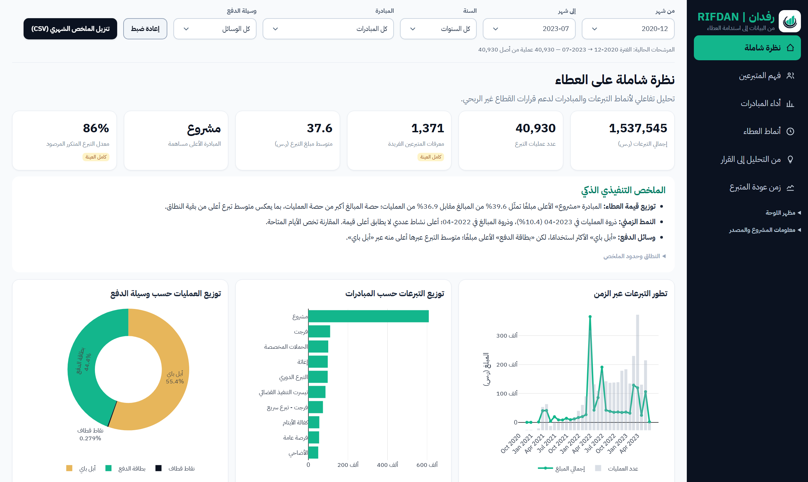

# RIFDAN | رفدان — Donation Analytics & Decision Support

**From data to sustainable giving.** RIFDAN explores a historical sample of **40,930 donations** from Saudi Arabia's Ehsan platform. The project connects data cleaning, statistical analysis, exploratory modelling, an interactive Arabic dashboard, and an executive report to identify **testable** opportunities—not to claim causal impact.

[](https://ziyadell.github.io/RIFDAN-Data-Analytics/outputs/dashboard/RIFDAN_Dashboard.html)

**[Explore the interactive dashboard](https://ziyadell.github.io/RIFDAN-Data-Analytics/outputs/dashboard/RIFDAN_Dashboard.html)** · **[Read the executive report](report/executive_summary.pdf)** · **[View the analysis notebook](analysis.ipynb)**

| At a glance | Historical sample |
|---|---:|
| Donations analysed | **40,930** |
| Total donated | **1,537,545 SAR** |
| Observed donor identifiers | **1,371** |
| Largest identifier's share of amounts | **27.2%** |

> **Interpretation:** This is a sample, not a view of all donors or current Ehsan activity. An observed identifier is not necessarily a complete history of a person. Raw and cleaned donor-level datasets are not redistributed in this repository.

## 📊 The problem

Nonprofits can report donation totals without necessarily knowing where contributions are concentrated or which retention opportunity is worth testing. This project asks:

> **Where is donation value concentrated in the sample, and what measurable intervention could a nonprofit test to encourage more sustainable giving?**

The objectives are to measure contribution concentration, examine time to a second observed donation, estimate the scale of a potential improvement, and translate the evidence into prioritised **experiment proposals**.

## 📈 Key findings

| Finding | Result |
|---|---|
| Donation count | 40,930 |
| Total donated | 1,537,545 SAR |
| Mean / median donation | 37.6 / 10 SAR |
| Largest identifier's share | 27.2% of donated amounts |
| Largest initiative | «مشروع», 39.6% of amounts |
| Second observed gift within 30 days | 50.1% (median 30 days) |
| Monthly entry-cohort return rates | 25.0%–70.9% (median 45.5%) |

**Decision priority:** First verify what the dominant identifier represents, report concentration with and without it, and consider donor diversification. Then test improvements to the second-gift journey using success criteria defined **before** the experiment. The dashboard documents **8 recommendations and 3 experiment plans**; these are not proven interventions.

## 🖥️ Interactive dashboard

The Arabic right-to-left dashboard is a self-contained HTML file, usable online or offline without running a server or supplying the underlying dataset.

| Page | Focus |
|---|---|
| نظرة شاملة | KPIs, time trends, initiatives and payment methods |
| فهم المتبرعين | Observed frequency, recency, value, segments and models |
| أداء المبادرات | Rankings, trends, opportunities and comparisons |
| أنماط العطاء | Monthly, weekday and hourly activity |
| زمن عودة المتبرع | Kaplan–Meier curves, cohorts, Cox estimates and value sizing |
| من التحليل إلى القرار | Evidence-based recommendations and experiment plans |

**Filters:** month range, year, initiative and payment method, with reset and monthly summary export. Donor-level modelling and recommendations apply to the **full sample**, not to arbitrary selected subsets, and the dashboard labels them accordingly. Privacy controls can cause small undercounts in a few narrowly filtered title or hour charts; see below.

## 🛠️ Technologies

| Area | Tools |
|---|---|
| Data and statistics | Python, pandas, NumPy, SciPy |
| Exploratory models | scikit-learn (K-Means, Logistic Regression, Gradient Boosting) |
| Time-to-event analysis | lifelines (Kaplan–Meier, Cox model) |
| Visualisation | matplotlib, seaborn, Plotly.js |
| Dashboard | HTML, CSS, JavaScript, Arabic RTL |
| Reporting | Jupyter, ReportLab, arabic-reshaper, python-bidi |
| Validation | Python, Node.js, jsdom |

## Data and preparation

**Source:** [A sample of donations for different IDs in Ehsan](https://open.data.gov.sa/ar/datasets/view/cc3b177a-5e5d-4845-bb92-6119b1322b05), from the Saudi Open Data Platform (Arabic: «عينة لتبرعات 1500 معرف على منصة احسان»).

| Item | Scope |
|---|---|
| Raw / cleaned records | 40,931 / 40,930 |
| Date coverage | 2020-12-14 to 2023-07-13; partial endpoint months; February 2021 absent |
| Scope | 1,371 observed identifiers; 22 initiatives; 3 payment methods |
| Source columns | `UserID`, `CreationTime`, `Title`, `Amount`, `InitiativeName`, `PaymentMethod` |
| Distinct titles | 1,702 raw / 1,701 cleaned |

Preparation standardised column names, trimmed strings, converted amounts and timestamps, removed **one non-numeric amount** and filled **one missing title** with «غير محدد». **202 apparently duplicate rows were flagged but retained**, because no unique transaction ID establishes that they are errors. Their impact was examined separately.

The raw and cleaned datasets are intentionally excluded. Their pseudonymous identifiers and uncertain redistribution permissions require care; see [data_raw/README.md](data_raw/README.md) for source and download guidance.

## Analytical methods and caveats

**RFM segmentation:** Log-transformed and standardised recency, frequency and monetary value; K-Means tested `k = 2–6`. Three practical segments were selected (silhouette **0.303**) although two segments performed best on silhouette (**0.386**). Stability across random seeds was assessed (minimum Adjusted Rand Index **1.00**).

**Time to second observed gift:** Kaplan–Meier analysis uses right censoring rather than treating every identifier without a second observed gift as a permanent non-returner. The analysed cohort contains **1,290 identifiers**: **1,137 returned**, **153 censored**.

**Confounding:** A first-gift-size difference appeared in unadjusted analysis (53.2% vs 45.5% 30-day return, `p = 0.0086`), but disappeared in a Cox model controlling for initiative and payment method (HR **0.980**, 95% CI **0.936–1.027**, `p = 0.40`). Relative to «إغاثة», entry through «الحملات المخصصة» (HR **0.72**) and «زكاة الفطر» (HR **0.62**) was associated with slower return. **The proportional-hazards assumption was not tested**, and the model's C-index (**0.588**) indicates limited explanatory power.

**Peak-window comparison:** A **2,000-resample identifier-level cluster bootstrap** respects repeated transactions per identifier. Confidence intervals for the amount difference both included zero: the peak stands out for **activity**, not demonstrated larger individual gifts.

**Value sizing:** A one-percentage-point improvement in second-gift return corresponds to a descriptive range of **129–2,451 SAR** (**0.01%–0.16%** of sample amounts). This is **not** an estimated causal effect and excludes programme costs.

**Exploratory return prediction:** Sequential time splits use only observations available before each cutoff. Logistic Regression was selected on validation data (AUC **0.774** vs Gradient Boosting **0.713**). Test AUC was **0.729**, compared with **0.707** for a donation-count baseline. The **0.022** advantage had a 95% interval of **−0.001 to +0.045**, so it does **not** establish a reliable improvement from one test window.

## Privacy safeguards and remaining risks

No published file exposes donor identifiers; notebook outputs mask identifiers, exact timestamps and donation titles. The dashboard aggregates before publication and was tested for reconstruction of individual transactions.

| Measure | Safeguard |
|---|---|
| Dates | Month-level dashboard views; no day-level filter |
| Hour patterns | Counts only; no amounts |
| Public donation titles | At least 5 observed identifiers **and** 5 transactions; privately named individuals additionally withheld |
| Small cells | Some title/hour cells below 3 transactions rolled up to year or whole period |
| Timestamps | First and last transaction times published as dates |

Of **1,701** titles, **532** are shown, representing **91.7%** of donation amounts. Small rolled-up cells may be omitted from narrow filters, so specific chart totals may undercount. Tests recovered **zero exact hours** for single transactions and **zero month associations** for single-transaction titles.

**Residual disclosure risks remain:** 84 month–initiative–payment cells (**0.21%** of transactions) each contain one exact amount; 146 whole-period title cells each represent one transaction; a dominant identifier contributes at least 85% of amounts in 3 initiatives and 37 shown titles. An unlabelled identifier-level segmentation scatter plot is also public. These caveats matter when interpreting public aggregates.

## Executive report

[The 8-page Arabic executive summary](report/executive_summary.pdf) covers the problem, cleaning, methods, results, recommendations, implementation plans and limitations. The report can be rebuilt from `outputs/metrics.json` and figures using `scripts/build_report.py`.

## Reproduction and validation

**Explore without data:** The [dashboard](outputs/dashboard/RIFDAN_Dashboard.html), [report](report/executive_summary.pdf), [notebook](analysis.ipynb), `outputs/metrics.json`, and figures can be read directly.

**Re-run using Python 3.13:** Download the dataset according to [data_raw/README.md](data_raw/README.md), then execute from the repository root:

```bash
python -m pip install -r requirements.txt
python scripts/run_analysis.py
python scripts/build_dashboard.py
python scripts/build_report.py
```

You may also run `python scripts/run_analysis.py path/to/file.csv` or restart and run all cells in `analysis.ipynb`. The `.gitignore` excludes donor-level files; never commit them.

**Validation without donor-level data:**

```bash
python validation/validate_public_release.py
npm install --prefix validation
node validation/validate_dashboard.cjs
```

**Validation with the dataset in `data_raw`:**

```bash
python validation/validate_project.py
python validation/validate_public_release.py --raw data_raw/A_sample_of__donations_for_different_IDs_in_Ehsan.csv
```

`validate_project.py` independently recomputes metrics and prepares 60 filter cases; `validate_dashboard.cjs` checks those cases with jsdom. These automated checks do not replace browser-based visual verification.

<details>
<summary><strong>Environment and reproducibility notes</strong></summary>

`requirements.txt` pins compatible package versions. The documented setup uses Python **3.13.18**, pandas **2.3.3**, NumPy **2.5.3**, matplotlib **3.11.2**, seaborn **0.13.2**, scikit-learn **1.9.1**, SciPy **1.18.1**, lifelines **0.30.3**, ReportLab **5.0.1**, arabic-reshaper **3.0.1**, and python-bidi **0.6.12**. Dashboard validation uses Node.js **26.13.0** and jsdom **30.1.3**.

Published metrics were recorded on Linux with pandas **3.0.5**, which conflicts with lifelines' declared `pandas<3` requirement and is not pinned. A Windows run with the pinned packages reproduced the substantive conclusions; minor differences included a Gradient Boosting validation AUC of **0.715** vs **0.713** and the sixth decimal of the Cox C-index. Figures may differ at file level across operating systems.

On Windows, set `PYTHONUTF8=1` if Arabic text triggers an encoding error in console output.

</details>

## Repository guide

| Resource | Location |
|---|---|
| Main analysis | [`analysis.ipynb`](analysis.ipynb) |
| Live dashboard source | [`outputs/dashboard/RIFDAN_Dashboard.html`](outputs/dashboard/RIFDAN_Dashboard.html) |
| Executive report | [`report/executive_summary.pdf`](report/executive_summary.pdf) |
| Project metrics and figures | [`outputs/`](outputs/) |
| Rebuild scripts | [`scripts/`](scripts/) |
| Privacy and release tests | [`validation/`](validation/) |
| Dataset instructions | [`data_raw/README.md`](data_raw/README.md) |
| License notices | [`data_license/`](data_license/), [`fonts/`](fonts/) |

## Limitations

- The available historical sample is not a representative or complete donor population; no observation does not imply no later donation.
- Start/end months are partial, February 2021 is missing, and the timezone is undocumented.
- Observed donor identifiers are pseudonyms; the data does not establish complete individual histories.
- No intervention, costs or targets were observed, so estimated value ranges are not causal ROI measures.
- The K-Means segments overlap, Cox assumptions were not fully tested, and prediction requires more out-of-time evaluation.
- «نقاط قطاف» appears as a payment method, but its interpretation is undocumented.

## Licensing and attribution

The [MIT licence](LICENSE) covers eligible original project code in `scripts/` and `validation/` and author-owned dashboard HTML/CSS/JavaScript. It **does not** relicense third-party data, derived analysis outputs, report, fonts or bundled libraries. The RIFDAN name and logo are not offered for reuse.

Data and derived outputs remain subject to the [Saudi Open Data License v2.0](https://open.data.gov.sa/ar/pages/policies/license) (see [license copy](data_license/Open_Data_License_Ar.pdf) and [Arabic attribution](data_license/ATTRIBUTION_AR.md)). Personal data is excluded by the licence's clause 4.3-d. IBM Plex Sans Arabic is licensed under SIL OFL 1.1; Plotly.js retains its own MIT licence.

> يحتوي هذا العمل على معلومات من مجموعة البيانات «A sample of donations for different IDs in Ehsan» المنشورة في منصة البيانات المفتوحة السعودية، المتاحة بموجب رخصة البيانات المفتوحة النسخة 2.0. التنظيف والتحليل من إعداد مؤلف المشروع ولا يعنيان اعتماد مانح الترخيص.

## Author

**Ziyad Jammah (زياد جماح)** · [X: @ziyadles](https://x.com/ziyadles) · [LinkedIn](https://www.linkedin.com/in/ziyad-jammah-008a28263)

<div dir="rtl">

## نبذة بالعربية

رفدان مشروع لتحليل عينة تاريخية تضم 40,930 عملية تبرع في منصة إحسان. يجمع تنظيف البيانات والتحليل الإحصائي والنمذجة الاستكشافية مع لوحة معلومات عربية تفاعلية وتقرير تنفيذي وتوصيات قابلة للاختبار. لا يتضمن المستودع الملفات الخام والمنظفة لحماية معرّفات المتبرعين، ويمكن استعراض لوحة المعلومات والتقرير دون الحاجة إلى البيانات الأصلية.

</div>
